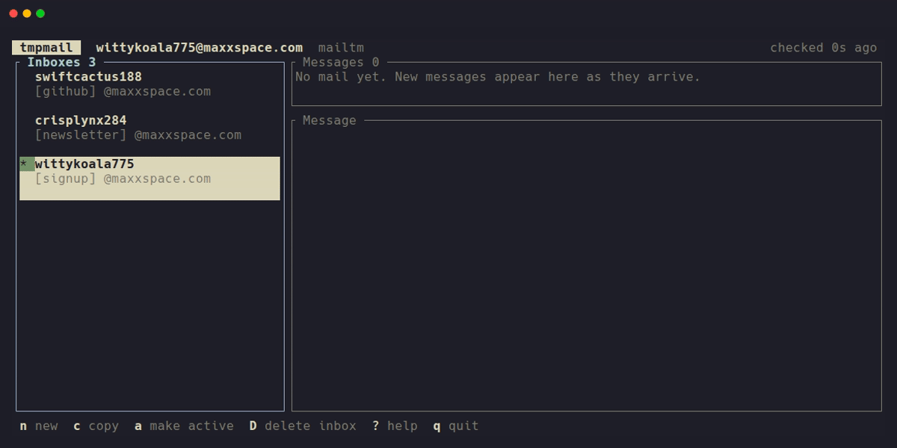

# tmpmail

Disposable email for scripts, tests and AI agents. Make an address, sign up with it, and
get the verification code back in one line of shell. When one provider is down, tmpmail
[moves on to the next](#choose-the-provider).

[](https://github.com/qorvyx/tmpmail/actions/workflows/ci.yml)
[](https://github.com/qorvyx/tmpmail/actions/workflows/providers.yml)
[](https://github.com/qorvyx/tmpmail/releases/latest)
[](https://crates.io/crates/tmpmail)
[](LICENSE)

```sh
addr=$(tmpmail new -q)                   # quickfox605@maxxspace.com
./signup.sh "$addr"                      # anything that sends a mail to it
tmpmail otp --wait --include-existing    # blocks until it arrives, then prints 482913
```


<sub>A real mail, sent to the new address by
[`assets/demo/send-test-mail.py`](assets/demo/send-test-mail.py) and delivered over
mail.tm's push stream. Recorded with [vhs](https://github.com/charmbracelet/vhs) from
[`assets/demo/demo.tape`](assets/demo/demo.tape).</sub>

## Install

```sh
cargo install tmpmail
```

With [cargo-binstall](https://github.com/cargo-bins/cargo-binstall), `cargo binstall tmpmail`
downloads the prebuilt binary instead of compiling. On macOS or Linux with Homebrew:

```sh
brew install qorvyx/tap/tmpmail
```

Use the full name: Homebrew's own `tmpmail` is a different project.

Or take a prebuilt binary from the [releases page](https://github.com/qorvyx/tmpmail/releases/latest):
Linux (x86_64, aarch64, fully static), macOS (Intel, Apple silicon) and Windows. Each
release has `SHA256SUMS`, and every file carries a GitHub build attestation that proves it
was built from this repository by the release workflow:

```sh
gh attestation verify tmpmail-0.1.2-x86_64-unknown-linux-musl.tar.gz --repo qorvyx/tmpmail
```

Nothing else is needed at runtime. Optional extras: `wl-copy`, `xclip`, `xsel` or `pbcopy`
for `copy`, a browser for `read --html`, `notify-send` for `watch --notify`.

## Use it

### In a script or CI

`wait` blocks until a matching mail arrives. `otp` prints just the code and `links` just
the links, verification links first. Every command takes `--json`, and exit codes tell a
timeout (2) apart from a dead provider (3).

```sh
addr=$(tmpmail new -q)
./signup.sh "$addr"
code=$(tmpmail otp --wait --include-existing --from 'acme' --timeout 120)
link=$(tmpmail wait --link --include-existing --subject 'confirm')
tmpmail --json ls | jq -r '.messages[0].subject'
```

`--include-existing` matters when the mail can arrive before `wait` starts. Without it,
`wait` only accepts mail that is new since the call. In GitHub Actions:

```yaml
- name: Install tmpmail
  run: |
    mkdir -p ~/.local/bin
    curl -sSfL https://github.com/qorvyx/tmpmail/releases/download/v0.1.2/tmpmail-0.1.2-x86_64-unknown-linux-musl.tar.gz \
      | tar xz --strip-components=1 -C ~/.local/bin tmpmail-0.1.2-x86_64-unknown-linux-musl/tmpmail
    echo "$HOME/.local/bin" >> "$GITHUB_PATH"

- name: Sign-up test
  run: |
    addr=$(tmpmail new -q)
    curl -sSf https://staging.example.com/signup -d "email=$addr"
    code=$(tmpmail otp --wait --include-existing --timeout 120)
    curl -sSf https://staging.example.com/verify -d "email=$addr" -d "code=$code"
```

The [daily provider check](.github/workflows/providers.yml) creates and lists inboxes from
GitHub's runners, so the free providers are known to work from CI.

### With an AI agent

`tmpmail mcp` is a [Model Context Protocol](https://modelcontextprotocol.io) server. An agent
can create an inbox, sign up somewhere and fetch the code without you:

```sh
claude mcp add tmpmail -- tmpmail mcp
```

Other clients take `{ "command": "tmpmail", "args": ["mcp"] }`. The tools are
`create_inbox`, `list_inboxes`, `list_messages`, `read_message`, `wait_for_message`,
`get_verification_code`, `get_links`, `delete_message` and `delete_inbox`. Waits run in
parallel and can be cancelled. Anyone can mail a temp address, so treat what the agent reads
there as untrusted input. [Details](docs/usage.md#mcp-server-for-ai-agents).

### In the terminal

`tmpmail tui` shows your inboxes, their mail and a preview, updated as mail arrives. A
verification code is highlighted, and `y` copies it.



The [guide](#guide) below shows each feature in a few lines, and [all commands](#commands)
are listed under Reference.

### Coming from the original tmpmail

[sdushantha/tmpmail](https://github.com/sdushantha/tmpmail) was a shell script on a single
backend, 1secmail, which has shut down. This is a rewrite in Rust, and the old interface
still works: `tmpmail -g [ADDR]`, `tmpmail`, `tmpmail -r`, `tmpmail ID`, `-d`, `-c`, `-t`.
It no longer needs `w3m`, `curl` or `jq`.
[Mapping of the old flags](docs/usage.md#original-tmpmail-flags).

## Guide

Each part is a plain explanation and the commands for it. The [provider table](#providers)
shows which services support what.

### Create an address

```sh
tmpmail new              # random, readable address, e.g. quickfox605@maxxspace.com
tmpmail new -c           # same, and copy it to the clipboard
tmpmail whoami           # show it again later
```

The new address becomes the *active* inbox: every other command uses it unless you say
otherwise (see [several inboxes](#several-inboxes)).

### Choose the username

The part before `@` is random by default. Pick your own with `-u`, or give the whole
address:

```sh
tmpmail new -u otter42
tmpmail new otter42@maxxspace.com
```

Works on mail.tm, mail.gw, Guerrilla Mail and Maildrop; `tmpmail new` skips the providers
that can't do it.

### Pick a domain

The part after `@`. List the domains a provider offers, then ask for one:

```sh
tmpmail domains                  # mail.tm's domains
tmpmail domains -p dropmail      # DropMail's (about 20 of them)
tmpmail new -d yomail.info       # tmpmail finds the provider that has it
```

Useful when a site blocks one disposable domain: try another. Works on mail.tm, mail.gw,
DropMail and Guerrilla Mail.

### Choose the provider

`tmpmail new` tries the providers in order (`mailtm, dropmail, guerrilla, tempmail_lol,
mailgw`) and uses the first one that works, telling you if it had to skip one. To use one
in particular, or change the order:

```sh
tmpmail new -p guerrilla             # only Guerrilla Mail, no fallback
tmpmail providers --check            # which ones are up right now
TMPMAIL_PROVIDER=dropmail,mailtm tmpmail new
```

The order can also be set for good in the [config file](#configuration).
In the TUI, `N` picks the provider.

### Read your mail

```sh
tmpmail                  # list messages, newest first (same as tmpmail ls)
tmpmail read 1           # read the newest; long ones open in a pager
tmpmail read 1 --html    # the HTML version in your browser, sanitized, no remote images
```

A message can be named by its number in the list, its id, or the first characters of its
id. With no number, commands use the newest message.

### Wait for a code or link

```sh
tmpmail otp --wait                    # wait for a new mail with a code, print the code
tmpmail wait --link --from github     # wait for a mail from GitHub, print its best link
tmpmail otp 1                         # the code in a message you already have
tmpmail links 1                       # every link in it, verification links first
```

Waiting gives up after 180 seconds (`-t` to change it) with exit code 2. It only accepts
mail that arrives after you start; add `--include-existing` if the mail may already be
there. `--from`, `--subject` and `--body` narrow it down, and plain words work.

### Live push

With mail.tm and DropMail, tmpmail keeps a connection open and the provider announces new
mail the moment it lands, so `wait`, `watch` and the TUI react in about a second. Other
providers are checked every 5 seconds. The TUI shows `● live` while the connection is up.
Nothing to set up; turn it off with `TMPMAIL_PUSH=0` or `push = false` in the config.

### Attachments

```sh
tmpmail attachments 1                 # list them
tmpmail save 1 -o ~/Downloads         # download all of them
tmpmail save 1 invoice.pdf            # or just one
```

File names are cleaned up and existing files are never overwritten. Works on mail.tm,
mail.gw, DropMail and Guerrilla Mail.

### Several inboxes

Give inboxes labels and switch between them by label, address, or the part before `@`:

```sh
tmpmail new -l github
tmpmail new -l shop
tmpmail inboxes                       # all of them, with expiry; * = active
tmpmail -i github ls                  # one command on another inbox
tmpmail use shop                      # make it the active one
tmpmail ls -a                         # mail in every inbox
tmpmail otp --wait -a                 # a code arriving at any of them
```

### Log back in

mail.tm and mail.gw inboxes are real accounts that last until you delete them. Set a
password to use one elsewhere, or log in to an account you made on their website:

```sh
tmpmail new -p mailtm --password 'correct horse'   # then log in on mail.tm with it
tmpmail login otter42@maxxspace.com --password 'correct horse'
```

DropMail sessions expire when idle. tmpmail brings the same address back automatically the
next time you use it, but mail from the expired session is gone. Guerrilla Mail sessions
are re-attached to the same address the same way. Maildrop
inboxes are public, so `tmpmail login name@maildrop.cc` needs no password.

### Clean up

```sh
tmpmail delete 1                      # delete one message
tmpmail delete --all                  # every message in the inbox
tmpmail drop                          # delete the inbox at the provider and forget it
tmpmail rotate                        # swap the active address for a fresh one
tmpmail watch --rotate 30m            # a fresh address every 30 minutes
tmpmail inboxes --prune               # forget inboxes that have expired
```

Deleting messages works on mail.tm, mail.gw, Guerrilla Mail and Maildrop.

## Providers

| Provider | Lifetime | [Username](#choose-the-username) | [Domain](#pick-a-domain) | [Attachments](#attachments) | [Push](#live-push) | [Delete](#clean-up) | [Log back in](#log-back-in) |
|---|---|:-:|:-:|:-:|:-:|:-:|:-:|
| [mail.tm](https://mail.tm) `mailtm` | until deleted; mail kept 7 days | ✓ | ✓ | ✓ | ✓ | ✓ | password |
| [DropMail.me](https://dropmail.me) `dropmail` | renewed while used | | ✓ | ✓ | ✓ | | automatic |
| [Guerrilla Mail](https://www.guerrillamail.com) `guerrilla` | mail kept 60 min | ✓ | ✓ | ✓ | | ✓ | automatic |
| [tempmail.lol](https://tempmail.lol) `tempmail_lol` | 1 hour | | | | | | |
| [mail.gw](https://mail.gw) `mailgw` | until deleted; mail kept 7 days | ✓ | ✓ | ✓ | | ✓ | password |
| [Maildrop](https://maildrop.cc) `maildrop` | 24 h without mail | ✓ | | | | ✓ | by name |

- **Maildrop is public**: anyone who guesses the name can read the inbox. It is never used
  unless you ask for it with `-p maildrop`, and its first mail may be delayed by greylisting.
- **tempmail.lol** is the last resort: no attachments, and a mail with a text attachment
  arrives with the attachment in place of its body.
- **mail.gw** runs the same software as mail.tm and is tried last.

How tmpmail picks one is under [choose the provider](#choose-the-provider). Only documented
APIs are used. Many sites block known disposable domains; [another domain](#pick-a-domain)
or provider usually gets through.

Thanks to **mail.tm** for its free API; per its terms this client links back to it.

## Reference

<a id="commands"></a>
<details>
<summary><b>Commands</b></summary>

| Command | What it does |
|---|---|
| `new [ADDR] [-u USER] [-d DOMAIN] [-p PROVIDER] [-l LABEL] [-c]` | Create an inbox (alias `generate`) |
| `ls [-a]` | List messages, newest first, `*` = unread; `-a` = all your inboxes |
| `read [ID\|N] [--recent] [--html [--images]] [--raw] [--no-pager]` | Show a message (long ones in a pager) |
| `wait [-a] [--from RE] [--subject RE] [--body RE] [--timeout S] [--otp\|--link] [--delete]` | Block until a matching message arrives |
| `otp [ID] [--regex RE] [--wait ...]` | Extract a verification code |
| `links [ID] [--match RE] [--first] [--open]` | Extract links, verification links first |
| `watch [-a] [--notify] [--rotate 30m]` | Stream new messages (JSON lines with `--json`); `--rotate` = fresh address on a timer |
| `attachments ID`, `save ID [ATT...] [-o DIR]` | List / download attachments |
| `delete ID`, `delete --all` | Delete messages |
| `whoami`, `copy`, `qr` | Show / copy / QR-code the active address |
| `inboxes [--prune]`, `use ADDR`, `-i ADDR` | Manage several inboxes (by address, local part or label) |
| `login ADDR --password PW` | Attach an existing mail.tm / mail.gw account |
| `rotate [--keep]` | Replace the active address with a fresh one |
| `domains [-p PROVIDER]`, `providers [--check]` | Domains, provider capabilities and live status |
| `tui` | Full-screen browser, updated live |
| `mcp` | MCP server on stdio for AI agents |
| `completions bash\|zsh\|fish`, `man [-o DIR]` | Shell completions, man pages |

Messages can be referenced by full id, by their number in `tmpmail ls`, or by a unique id
prefix. Every option is explained in [docs/usage.md](docs/usage.md), and the `--json`
output in [docs/json.md](docs/json.md).

</details>

<details>
<summary><b>Exit codes</b></summary>

| Code | Meaning |
|---|---|
| 0 | success |
| 1 | other error |
| 2 | `wait` timed out |
| 3 | provider failure (unreachable, rate limited, auth, bad response) |
| 4 | nothing found (no inbox, no such message, no code in the message) |
| 64 | usage error (bad flag, unsupported option for this provider) |

In `--json` mode, errors are printed as `{"error":{"kind":"...","message":"..."}}`.

</details>

<a id="configuration"></a>
<details>
<summary><b>Configuration and environment</b></summary>

`~/.config/tmpmail/config.toml` (or `$TMPMAIL_CONFIG`), all optional:

```toml
providers = ["mailtm", "guerrilla"]   # fallback order for `new`
browser = "firefox"                   # for --html and links --open
clipboard_cmd = "wl-copy"
pager = "less"                        # for long messages in `read` (default $PAGER, else less)
poll_interval = 5                     # seconds, for wait/watch
timeout = 180                         # default wait timeout
push = true                           # live push from mail.tm/DropMail in wait/watch
```

Environment: `TMPMAIL_PROVIDER` (comma list), `TMPMAIL_TIMEOUT`, `TMPMAIL_POLL_INTERVAL`,
`TMPMAIL_PUSH`, `TMPMAIL_INBOX`, `TMPMAIL_PASSWORD`, `TMPMAIL_STATE_DIR`,
`TMPMAIL_DROPMAIL_TOKEN`, `PAGER`, `NO_COLOR`.

</details>

## Privacy and security

- State (addresses and their credentials) lives in `$XDG_STATE_HOME/tmpmail/state.json`
  (`~/.local/state/tmpmail`), directory `0700`, file `0600`, never in `/tmp`.
- Message text is stripped of terminal control sequences before printing.
- `read --html` writes a sanitized copy (no scripts, forms, frames; strict CSP) and
  **blocks remote images** (tracking pixels) unless you pass `--images`. These copies are
  deleted after a day.
- Attachment names are sanitized so they can't escape the target directory, and
  existing files are never overwritten.
- `tmpmail mcp` hands message contents to an AI agent. Anyone can mail a temp address, so
  treat what the agent reads there as untrusted input.
- No telemetry. The only network traffic is to the provider you use.

## Development

```sh
cargo test                  # unit tests + provider tests against a mock HTTP server
cargo clippy --all-targets
./scripts/smoke.sh          # live check against the real providers (creates throwaway inboxes)
vhs assets/demo/demo.tape   # re-record the demo (needs vhs, and outbound SMTP for the test mail)
```

## License

GPL-3.0-or-later. See [LICENSE](LICENSE).
